# RaceDay

A web-based event management system for the South African road running, walking and cycling community.

Organisers create and manage events, define age or distance categories, see who has entered, and capture finish times once the race is over. Participants register, browse events, enter under a category of their choice, and track their own race history.

**Module:** PROG6212 Programming 2B — Portfolio of Evidence
**Part 2:** RESTful API in ASP.NET Core Web API, Entity Framework Core (code-first) against SQL Server, session-based role authentication, Swagger, and unit tests running in GitHub Actions.
**Part 3:** ASP.NET Core MVC front end with role-aware Organiser and Participant interfaces, Azure Blob Storage for event banners and profile pictures, a Docker container for the MVC app, and a CI pipeline that builds and tests both projects and the image. Part 3 lives on the `part3-mvc` branch.

---

## Video walkthrough

**[Watch the Part 2 video walkthrough](https://youtu.be/8Hr-RUQB_WE)**

**Part 3 video walkthrough:** _add the unlisted YouTube link here_

---

## CI/CD build status

The GitHub Actions workflow (`.github/workflows/ci.yml`) runs three jobs on every push:

1. **Validate repository structure** — docs, both projects, both test projects, the Dockerfile and README are present, and the MVC project has no database or Azure packages.
2. **Build API and MVC, run unit tests** — restores and builds `RaceDay.Api` and `RaceDay.Mvc`, then runs all 83 unit tests (54 API, 29 MVC).
3. **Build the MVC Docker image** — builds the image, starts the container with the documented `docker run` command and checks it serves pages.

Part 3 build (`part3-mvc` branch):

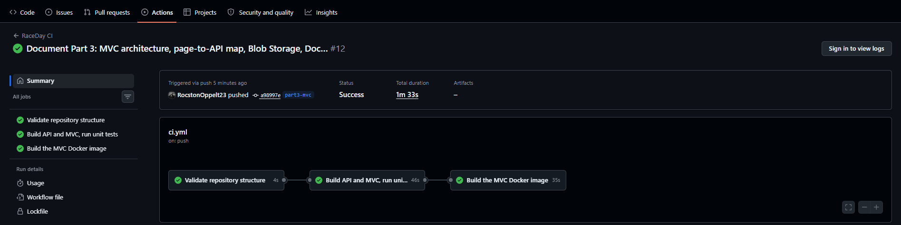

Part 2 build:


---

## The two roles

| Role | What they can do |
|---|---|
| **Organiser** | Create, edit and delete their own events. Add, edit and remove categories on those events. View every enrolment for their events. Capture, edit and remove participant results. Look up a participant's basic details. |
| **Participant** | Register an account, browse events, enter an event under a category, view and cancel their own enrolments, and track their own results. |

Role checks run on the server. On login the API stores the user's `UserId` and `Role` in the session, and every protected endpoint reads the id from that session rather than from the request body — so a user can never act as someone else by editing a request.

Beyond the role check, ownership is enforced: an Organiser can only touch events they created, and a Participant can only see or cancel their own enrolments and results. Anything else returns `403 Forbidden`.

---

## Project structure

```
RaceDay/
├── RaceDay.Api/                  ASP.NET Core Web API
│   ├── Controllers/              Auth, Users, Events, Categories, Enrolments, Results
│   ├── Data/AppDbContext.cs      EF Core context — keys, constraints, relationships
│   ├── Dtos/                     Request models
│   ├── Filters/                  RequireRole and RequireLogin authorisation filters
│   ├── Models/                   User, UserProfile, Event, Category, Enrolment, Result
│   ├── Services/                 Azure Blob Storage service and image checks
│   └── Program.cs                Services, session and middleware setup
├── RaceDay.Api.Tests/            xUnit test project — 54 tests
├── RaceDay.Mvc/                  ASP.NET Core MVC front end (no database of its own)
│   ├── Controllers/              Account, Home, Dashboard, Events, Categories, Enrolments, Results, Profile
│   ├── Services/                 IApiClient / ApiClient — the only way the MVC app reaches data
│   ├── Filters/                  RequireSessionRole and the friendly API-error filter
│   ├── ViewModels/               Auth, Event, Enrolment, Result and Profile view models
│   ├── Views/                    Razor views, with the role-aware menu in Shared/_Layout.cshtml
│   ├── wwwroot/css/site.css      RaceDay brand colours and typography
│   └── Dockerfile                Multi-stage build for the container
├── RaceDay.Mvc.Tests/            xUnit test project — 29 tests
├── docs/                         Part 1 planning documents
│   ├── RaceDay_ERD.png           Entity relationship diagram
│   ├── API_Endpoint_Plan.pdf     Full endpoint table
│   └── RaceDay_Schema.sql        Schema and seed data script
└── .github/workflows/ci.yml      Structure validation, build and test
```

---

## Setup and run

### What you need

- .NET 10 SDK — check with `dotnet --list-sdks`
- SQL Server (LocalDB, Express or full) and SQL Server Management Studio
- Visual Studio 2022 or later

### 1. Clone

```bash
git clone https://github.com/RocstonOppelt23/RaceDay.git
cd RaceDay
```

Open `RaceDay.sln`.

### 2. Point the API at your database

The connection string is in `RaceDay.Api/appsettings.json` and defaults to LocalDB:

```
Server=(localdb)\MSSQLLocalDB;Database=RaceDay;Trusted_Connection=True;TrustServerCertificate=True;
```

On SQL Server Express, change the server to `localhost\SQLEXPRESS`. Use whatever instance name appears in the SSMS connection dialog.

### 3. Create the database

The `InitialCreate` migration is already in the repo. In the Package Manager Console, with `RaceDay.Api` as the default project, run:

```
Update-Database
```

Or run `docs/RaceDay_Schema.sql` in SSMS, which produces the same schema plus the Part 1 seed data.

### 4. Run the API

Press F5, or:

```bash
dotnet run --project RaceDay.Api
```

Swagger opens at `https://localhost:<port>/swagger`, with every endpoint described — its purpose, the data it expects, and the responses it returns.

### 5. Run the tests

```bash
dotnet test
```

Or Test → Run All Tests in Visual Studio.

---

## Trying the API in Swagger

The session rides on a cookie, so do all of this in the same browser tab.

1. `POST /api/auth/register` — create an Organiser
2. `POST /api/auth/register` — create a Participant
3. `GET /api/events` before logging in → **401 Unauthorized**
4. `POST /api/auth/login` with a wrong password → **401 Unauthorized**
5. `POST /api/auth/login` as the Organiser
6. `POST /api/events` — create an event
7. `POST /api/events/{eventId}/categories` — add a category
8. `POST /api/auth/logout`, then log in as the Participant
9. `POST /api/events` as the Participant → **403 Forbidden**
10. `POST /api/events/{eventId}/enrolments` — enter the event
11. The same call again → **409 Conflict**
12. `GET /api/users/profile` — returns the Participant, not the Organiser
13. Log out, log in as the Organiser
14. `GET /api/events/{eventId}/enrolments` — see the entrant
15. `POST /api/enrolments/{enrolmentId}/result` — capture `00:52:35`, position `12`
16. Log in as the Participant, `GET /api/results/my`

---

## Unit tests

47 tests across six classes, covering the success and failure paths the brief requires.

| Area | Covered |
|---|---|
| Registration and login | Password hashed rather than stored, an empty profile row created, invalid role rejected, duplicate email returns 409, session holds id and role on login, wrong password and unknown email both return 401, logout clears the session |
| Role enforcement | The filters themselves: no session → 401; Participant on an Organiser action → 403; Organiser on a Participant action → 403; matching role allowed |
| Event management | Organiser can create with the owner taken from the session, invalid event type and zero distance rejected, owner can update, another organiser blocked with 403, delete works with no enrolments and is blocked when entrants exist |
| User profiles | A user reads only their own record, updates save to both tables, an email already in use is rejected, missing details rejected |
| Event enrolments | Participant enters and the row records participant, event and category with status Active; duplicate entry returns 409; a category from another event rejected; unknown event returns 404; participants see only their own rows; organisers see only their own events' entrants; cancelling sets Status to Cancelled; another participant cannot cancel |
| Results | Owning organiser captures, duplicate result rejected, position zero rejected, another organiser blocked, unknown enrolment returns 404, participants see only their own results, event results listed for the owner, update and delete work for the owner |

Tests use an in-memory EF Core database, so they need no SQL Server and run identically locally and in GitHub Actions.

---

## Database design notes

The EF Core model matches `docs/RaceDay_Schema.sql` exactly — same six tables, keys, unique constraints, check constraints and delete rules.

**Foreign keys on Enrolments use `NO ACTION`.** SQL Server rejects a schema with multiple cascade paths to the same table, and both `Users → Events → Enrolments` and `Users → Enrolments` reach `Enrolments`. Deleting an event that still has entrants is therefore blocked in the API and returns a clear `400`, which is also the safer behaviour — entrant records are never silently removed. `UserProfiles`, `Categories` and `Results` do cascade, since none of them has a second path and none has meaning without its parent.

**`UNIQUE (ParticipantId, EventId, CategoryId)`** on `Enrolments` enforces one entry per participant, per event, per category at database level rather than only in code.

---

## Differences from the Part 1 plan

Three small deviations, all noted here as the brief requires.

**`GET /api/events` is open to both roles.** The Part 1 plan lists it as Participant only, but the Part 2 functional requirements state that both roles must be able to view events, and an Organiser who cannot list events cannot manage them. It is implemented as any logged-in user.

**`DELETE /api/enrolments/{id}` is a soft cancel.** The plan describes it as "cancel an enrolment" and the `Enrolments` table carries a `Status` column with values `Active` and `Cancelled`. Rather than delete the row, the endpoint sets `Status` to `Cancelled` and returns `204`, so the entry history and any result captured against it survive.

**The Part 1 ERD labelled the `UserProfiles` primary key as `ResultID`.** That was a typo in the diagram — the Part 1 SQL script defines it correctly as `ProfileId`. The ERD in `docs/` has been corrected to match the script and the code.

---

## Part 3 — MVC front end, Blob Storage and Docker

### How the pieces fit

```
Browser ──► RaceDay.Mvc (port 7201) ──HTTP──► RaceDay.Api (port 7101) ──► SQL Server
                                                       │
                                                       └──► Azure Blob Storage (banners, profile pictures)
```

- **The MVC app never touches a database or Azure.** Every page calls the Part 2 API through one `IApiClient` service. The MVC project references no EF Core, SqlClient or Azure packages (the CI checks this).
- **Two sessions, kept in step.** On login the API sets its own session cookie. `ApiClient` captures that cookie into the user's MVC session and sends it with every later API call, so each browser user has their own API session and the API's role and ownership checks keep working. The MVC session also holds `UserId`, `Role` and `FullName` for the menu and page filters.
- **Uploads go through the API.** Event banners and profile pictures are posted to the API as `multipart/form-data`; the API stores them in Blob Storage (`event-banners` and `profile-pictures` containers) and saves the blob URL. The banner travels in the same request as the event fields.

### Role-aware navigation

| Role | Menu | Lands on after login |
|---|---|---|
| Not logged in | Home, Register, Log In | Home — public list of upcoming events |
| Organiser | Dashboard, My Events, Enrolments, Results, Log Out | Dashboard |
| Participant | Browse Events, My Enrolments, My Results, Profile, Log Out | Browse Events |

Pages are protected by `[RequireSessionRole]`, an MVC action filter that reads the MVC session: no login sends you to Log In (and back afterwards), the wrong role sends you to Access Denied.

### What each role can do

| Organiser | Participant |
|---|---|
| Dashboard: total, upcoming and past events, active enrolments, and each upcoming event's entrant count | Browse upcoming events, filtered by type, date and name or place |
| Create, edit and delete events, with a banner image | Event details with banner, categories and one-click entry |
| Add and remove categories per event | My Enrolments with colour-coded status (green Active, red Cancelled), and cancel an entry |
| Entrant list per event: participant, category, status and result | My Results: event, date, category, finish time, position, best position and podiums |
| Capture finish time and position, and view each event's results | Profile: view, update details, upload a profile picture |

### MVC page → API endpoint

| MVC page | API call |
|---|---|
| Account/Register | `POST /api/auth/register` |
| Account/Login | `POST /api/auth/login` — stores UserId, Role, FullName and the API session cookie |
| Account/Logout | `POST /api/auth/logout`, then clears the MVC session |
| Home/Index | `GET /api/events/upcoming` (public, added in Part 3) |
| Dashboard/Index | `GET /api/events` filtered to the organiser, `GET /api/events/{id}/enrolments` per event |
| Events/Browse | `GET /api/events` |
| Events/Details | `GET /api/events/{id}`, `GET /api/events/{id}/categories`, `GET /api/enrolments/my` |
| Events/Create, Edit | `POST /api/events`, `PUT /api/events/{id}` — multipart with the banner |
| Events/Delete | `DELETE /api/events/{id}` |
| Categories/Manage | `GET`/`POST /api/events/{id}/categories`, `DELETE /api/categories/{id}` |
| Enrolments/Enrol | `POST /api/events/{id}/enrolments` |
| Enrolments/MyEnrolments, Cancel | `GET /api/enrolments/my`, `DELETE /api/enrolments/{id}` |
| Enrolments/EventEnrolments | `GET /api/events/{id}/enrolments`, `GET /api/events/{id}/results` |
| Results/Capture | `POST /api/enrolments/{id}/result` |
| Results/MyResults | `GET /api/results/my` |
| Profile/Index, Edit | `GET`/`PUT /api/users/profile`, `POST /api/users/profile/picture` |

### API changes for Part 3

- `BlobStorageService` (Azure.Storage.Blobs) registered in `Program.cs`; connection string in `appsettings.json` under `AzureBlobStorage:ConnectionString`.
- `Event.BannerImageUrl` column added with the `AddEventBannerImage` migration (`UserProfile.ProfilePictureUrl` already existed).
- `POST`/`PUT /api/events` accept `multipart/form-data` with an optional `bannerImage`.
- New `POST /api/users/profile/picture` and public `GET /api/events/upcoming`.
- Images are checked before upload: JPG, PNG, WEBP or GIF, 5 MB at most.

### Handling bad input and failures

- Every form has data-annotation validation (client and server). API errors are shown as the API's own message, e.g. "You are already entered for this event and category."
- If the API is not running, users see a "RaceDay is having trouble right now" page, not a stack trace.
- If the API session expires while the MVC session is still alive, the user is sent to Log In with a message.
- Unknown pages and events show a friendly 404 page; any other error shows a friendly error page.

### Running Part 3 locally

1. **Blob Storage.** For local work, run the Azurite emulator (the default connection string `UseDevelopmentStorage=true` points at it):
   ```bash
   npm install -g azurite
   azurite --silent --location ./azurite
   ```
   Or use a real Azure Storage account: paste its connection string into `RaceDay.Api/appsettings.json` and turn on **Allow Blob anonymous access** on the account so the browser can display the images.
2. **Database.** Apply the new migration: `Update-Database` in the Package Manager Console (or `dotnet ef database update --project RaceDay.Api`).
3. **API.** Run `RaceDay.Api` (it listens on `https://localhost:7101`).
4. **MVC.** Run `RaceDay.Mvc` (it opens on `https://localhost:7201`). `ApiBaseUrl` in `RaceDay.Mvc/appsettings.json` must match the API's address.

In Visual Studio, right-click the solution → *Configure Startup Projects* → *Multiple startup projects* → start both `RaceDay.Api` and `RaceDay.Mvc`.

### Running the MVC app in Docker

Start the API so the container can reach it through Docker's host gateway:

```bash
dotnet run --project RaceDay.Api --urls "https://0.0.0.0:7101"
```

Build the image from the `RaceDay.Mvc` folder:

```bash
cd RaceDay.Mvc
docker build -t raceday-mvc .
```

Run the container with this single command:

```bash
docker run -d -p 8080:8080 -e ApiBaseUrl=https://host.docker.internal:7101 -e ApiAcceptAnyCertificate=true --name raceday-mvc raceday-mvc
```

Open **http://localhost:8080**. `host.docker.internal` lets the container reach the API on your machine; `ApiAcceptAnyCertificate=true` lets it trust the API's local development certificate (leave it off in production).

The Dockerfile is multi-stage: the .NET SDK image restores, builds and publishes the app, and only the published output is copied into the smaller ASP.NET runtime image.

### Part 3 unit tests

29 tests in `RaceDay.Mvc.Tests`, plus 7 new API tests (54 in total for the API).

| Area | Covered |
|---|---|
| API client | The API's session cookie is captured at login and sent on later calls; 404 returns no data; 401 for a logged-in user raises "session expired"; an unreachable API raises "unavailable"; API error messages are read from plain text and ProblemDetails |
| Role filter | Not logged in → Login with the return URL; wrong role → Access Denied (both directions); matching role and any-login pages allowed through |
| Login flow | Organiser lands on Dashboard, Participant on Browse; session holds UserId, Role and FullName; wrong password stays on the form; a taken email shows the API's message; logout clears the session |
| Form validation | Past dates rejected for new events, unknown event types and zero distance rejected, mismatched passwords rejected, finish time must be hh:mm:ss |
| API (new) | Banner upload stores the blob URL; non-image files rejected with nothing uploaded; editing without a new banner keeps the old one; the public upcoming list excludes past events; profile picture upload, oversized image and missing file |

### Screenshots

| | |
|---|---|
| Public home 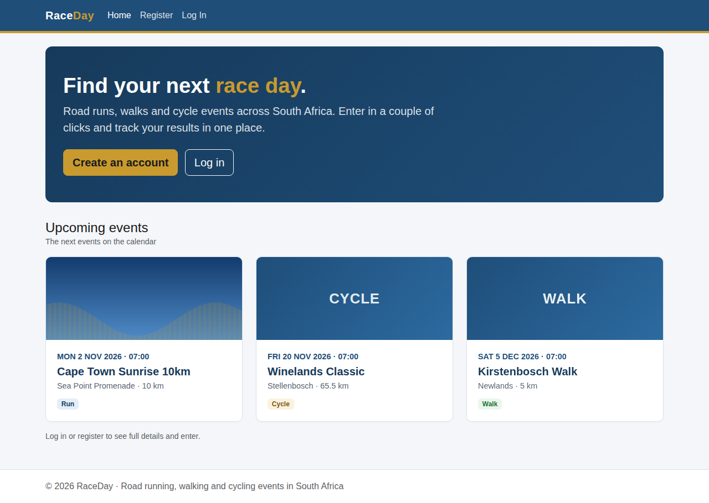 | Organiser dashboard 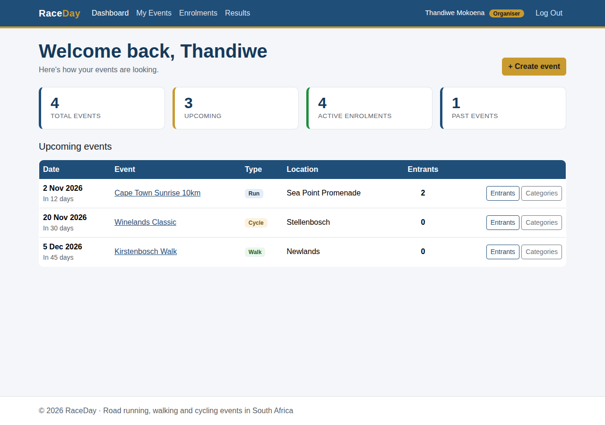 |
| Create event with banner 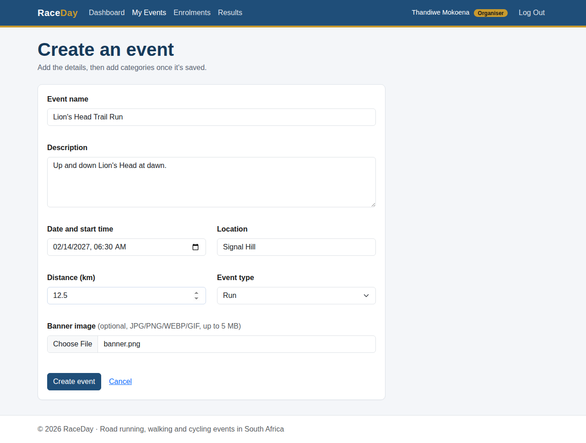 | Event details (organiser) 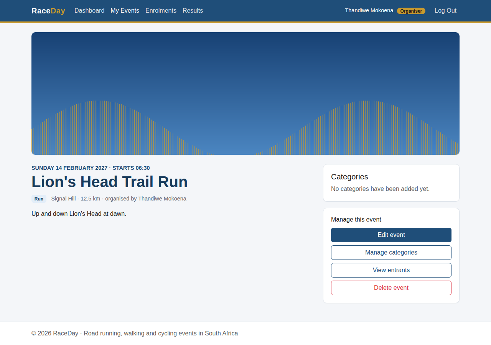 |
| Categories 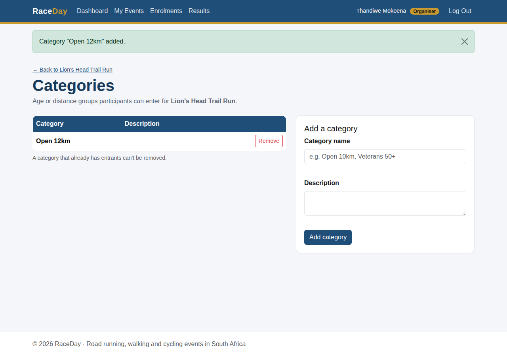 | Entrants with captured result 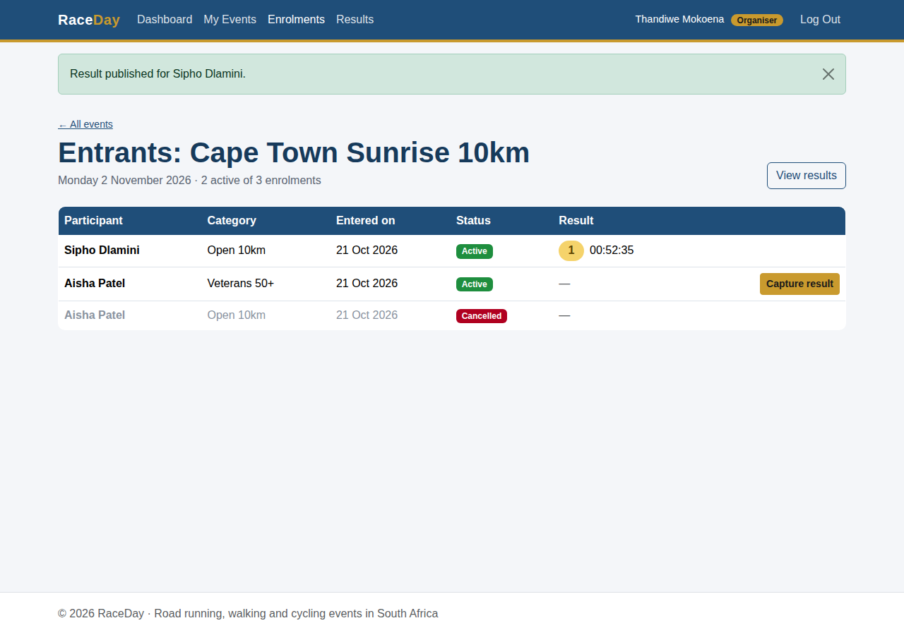 |
| Participant browse 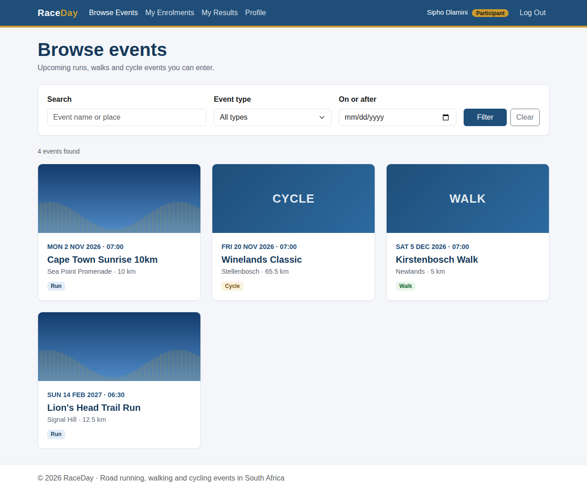 | Event details and entry 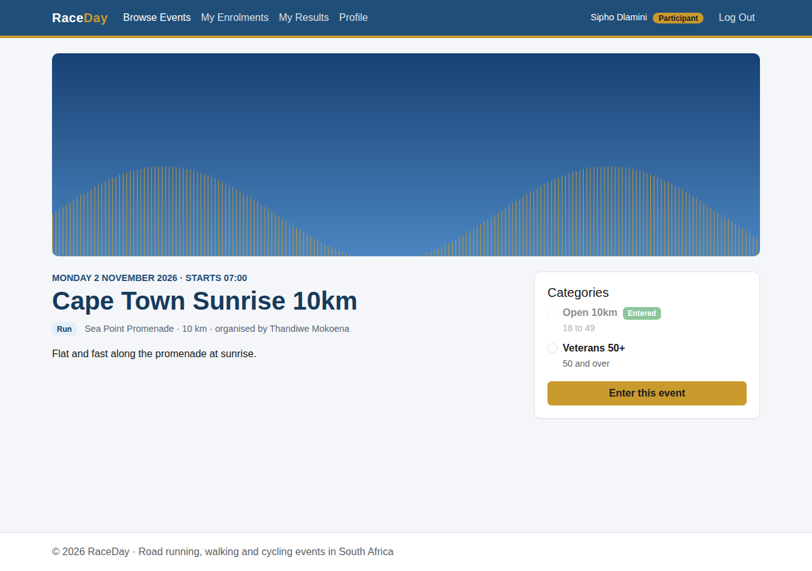 |
| My Enrolments (colour-coded) 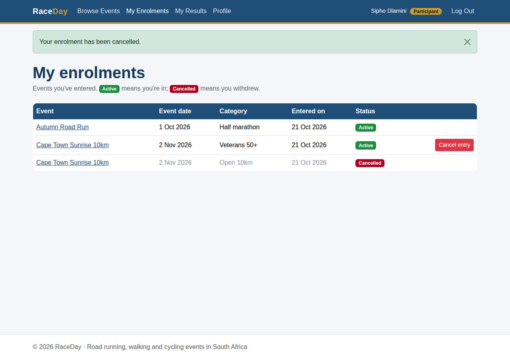 | My Results 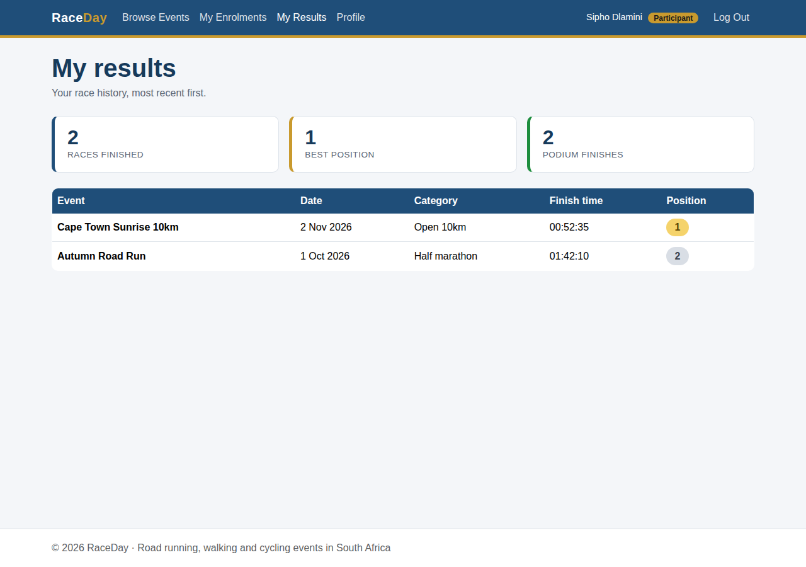 |
| Profile with picture 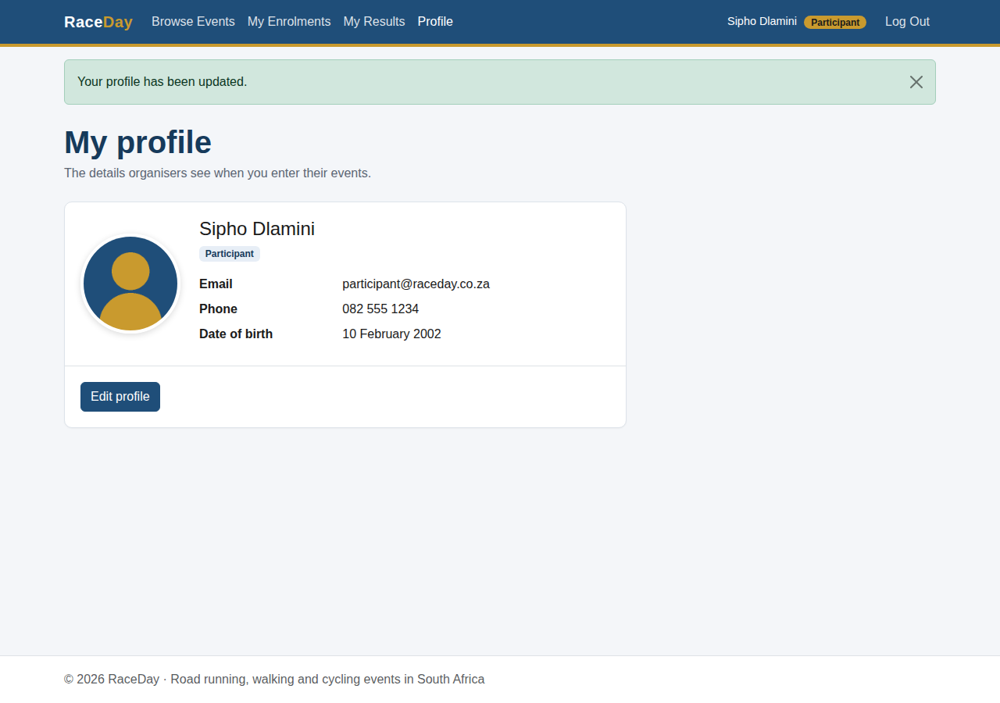 | Access denied for the wrong role 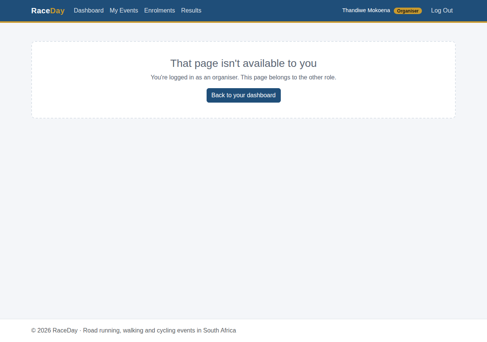 |
| Validation errors 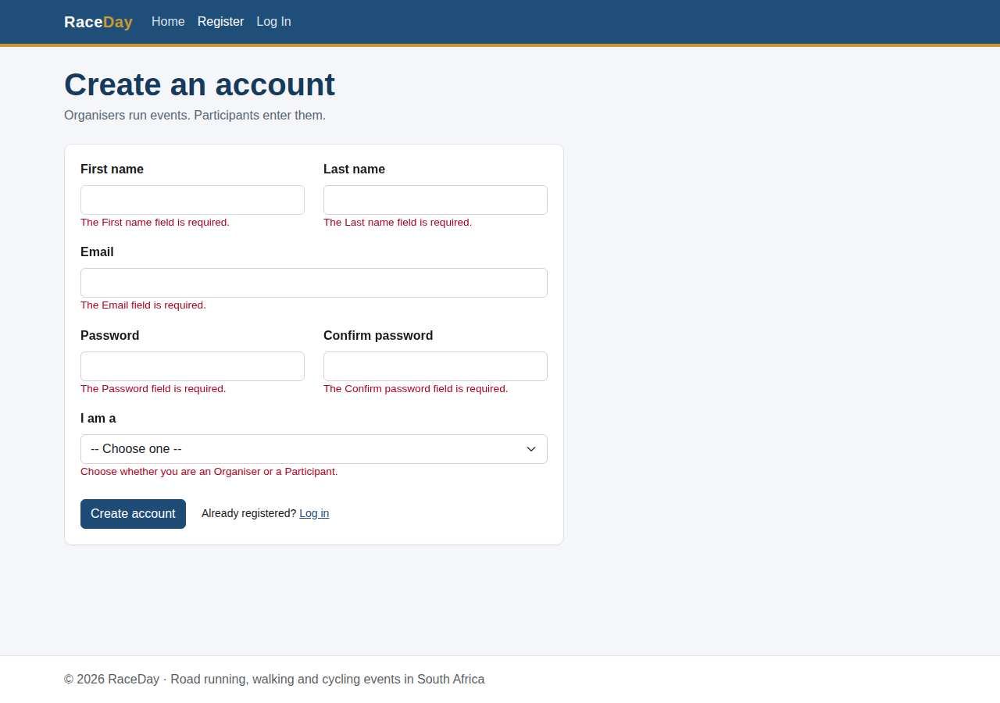 | API unavailable 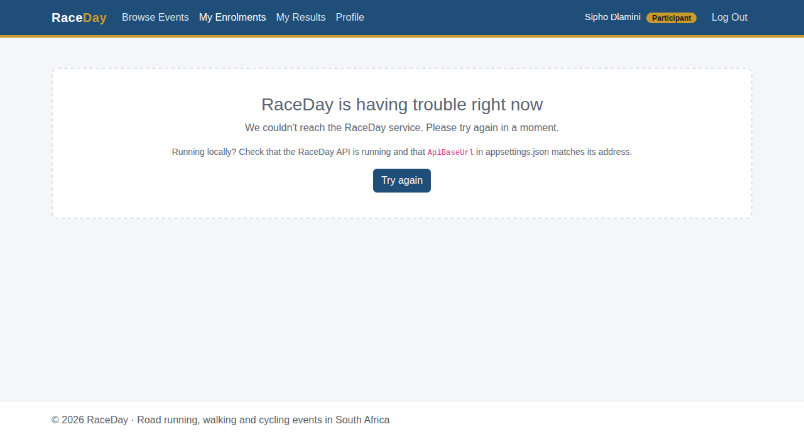 |

---

## AI usage disclosure

AI assistance was used during this project for code scaffolding, explanation of Entity Framework Core relationship configuration, and review of test coverage. All code was reviewed, built and tested locally before being committed.
