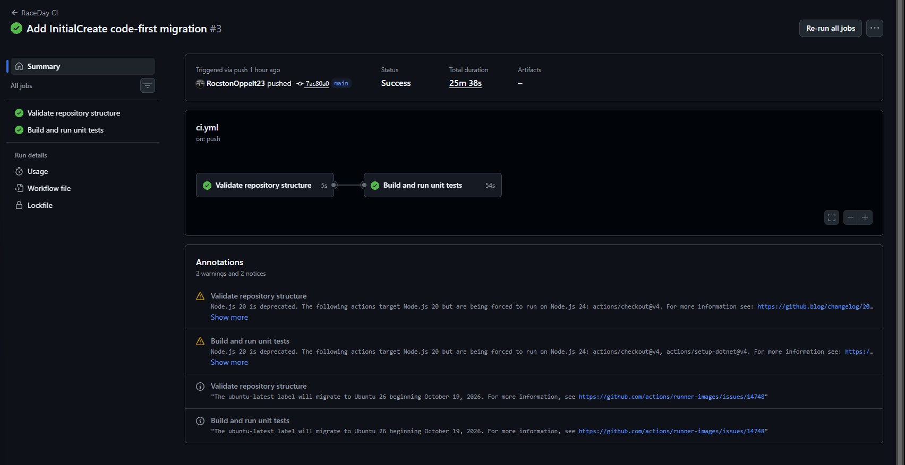

# RaceDay

A web-based event management system for the South African road running, walking and cycling community.

Organisers create and manage events, define age or distance categories, see who has entered, and capture finish times once the race is over. Participants register, browse events, enter under a category of their choice, and track their own race history.

**Module:** PROG6212 Programming 2B — Portfolio of Evidence
**Part 2:** RESTful API in ASP.NET Core Web API, Entity Framework Core (code-first) against SQL Server, session-based role authentication, Swagger, and unit tests running in GitHub Actions.

---

## Video walkthrough

**[Part 2 video — unlisted YouTube link goes here]**

---

## CI/CD build status

The GitHub Actions workflow validates the repository structure, builds the solution and runs all 47 unit tests on every push.



---

## The two roles

| Role | What they can do |
|---|---|
| **Organiser** | Create, edit and delete their own events. Add, edit and remove categories on those events. View every enrolment for their events. Capture, edit and remove participant results. Look up a participant's basic details. |
| **Participant** | Register an account, browse events, enter an event under a category, view and cancel their own enrolments, and track their own results. |

Role checks run on the server. On login the API stores the user's `UserId` and `Role` in the session, and every protected endpoint reads the id from that session rather than from the request body — so a user can never act as someone else by editing a request.

Beyond the role check, ownership is enforced: an Organiser can only touch events they created, and a Participant can only see or cancel their own enrolments and results. Anything else returns `403 Forbidden`.

---

## Project structure

```
RaceDay/
├── RaceDay.Api/                  ASP.NET Core Web API
│   ├── Controllers/              Auth, Users, Events, Categories, Enrolments, Results
│   ├── Data/AppDbContext.cs      EF Core context — keys, constraints, relationships
│   ├── Dtos/                     Request models
│   ├── Filters/                  RequireRole and RequireLogin authorisation filters
│   ├── Models/                   User, UserProfile, Event, Category, Enrolment, Result
│   └── Program.cs                Services, session and middleware setup
├── RaceDay.Api.Tests/            xUnit test project — 47 tests
├── docs/                         Part 1 planning documents
│   ├── RaceDay_ERD.png           Entity relationship diagram
│   ├── API_Endpoint_Plan.pdf     Full endpoint table
│   └── RaceDay_Schema.sql        Schema and seed data script
└── .github/workflows/ci.yml      Structure validation, build and test
```

---

## Setup and run

### What you need

- .NET 10 SDK — check with `dotnet --list-sdks`
- SQL Server (LocalDB, Express or full) and SQL Server Management Studio
- Visual Studio 2022 or later

### 1. Clone

```bash
git clone https://github.com/RocstonOppelt23/RaceDay.git
cd RaceDay
```

Open `RaceDay.sln`.

### 2. Point the API at your database

The connection string is in `RaceDay.Api/appsettings.json` and defaults to LocalDB:

```
Server=(localdb)\MSSQLLocalDB;Database=RaceDay;Trusted_Connection=True;TrustServerCertificate=True;
```

On SQL Server Express, change the server to `localhost\SQLEXPRESS`. Use whatever instance name appears in the SSMS connection dialog.

### 3. Create the database

Code-first, in the Package Manager Console with `RaceDay.Api` as the default project:

```
Add-Migration InitialCreate
Update-Database
```

Or run `docs/RaceDay_Schema.sql` in SSMS, which produces the same schema plus the Part 1 seed data.

### 4. Run the API

Press F5, or:

```bash
dotnet run --project RaceDay.Api
```

Swagger opens at `https://localhost:<port>/swagger`, with every endpoint described — its purpose, the data it expects, and the responses it returns.

### 5. Run the tests

```bash
dotnet test
```

Or Test → Run All Tests in Visual Studio.

---

## Trying the API in Swagger

The session rides on a cookie, so do all of this in the same browser tab.

1. `POST /api/auth/register` — create an Organiser
2. `POST /api/auth/register` — create a Participant
3. `GET /api/events` before logging in → **401 Unauthorized**
4. `POST /api/auth/login` with a wrong password → **401 Unauthorized**
5. `POST /api/auth/login` as the Organiser
6. `POST /api/events` — create an event
7. `POST /api/events/{eventId}/categories` — add a category
8. `POST /api/auth/logout`, then log in as the Participant
9. `POST /api/events` as the Participant → **403 Forbidden**
10. `POST /api/events/{eventId}/enrolments` — enter the event
11. The same call again → **409 Conflict**
12. `GET /api/users/profile` — returns the Participant, not the Organiser
13. Log out, log in as the Organiser
14. `GET /api/events/{eventId}/enrolments` — see the entrant
15. `POST /api/enrolments/{enrolmentId}/result` — capture `00:52:35`, position `12`
16. Log in as the Participant, `GET /api/results/my`

---

## Unit tests

47 tests across six classes, covering the success and failure paths the brief requires.

| Area | Covered |
|---|---|
| Registration and login | Password hashed rather than stored, an empty profile row created, invalid role rejected, duplicate email returns 409, session holds id and role on login, wrong password and unknown email both return 401, logout clears the session |
| Role enforcement | The filters themselves: no session → 401; Participant on an Organiser action → 403; Organiser on a Participant action → 403; matching role allowed |
| Event management | Organiser can create with the owner taken from the session, invalid event type and zero distance rejected, owner can update, another organiser blocked with 403, delete works with no enrolments and is blocked when entrants exist |
| User profiles | A user reads only their own record, updates save to both tables, an email already in use is rejected, missing details rejected |
| Event enrolments | Participant enters and the row records participant, event and category with status Active; duplicate entry returns 409; a category from another event rejected; unknown event returns 404; participants see only their own rows; organisers see only their own events' entrants; cancelling sets Status to Cancelled; another participant cannot cancel |
| Results | Owning organiser captures, duplicate result rejected, position zero rejected, another organiser blocked, unknown enrolment returns 404, participants see only their own results, event results listed for the owner, update and delete work for the owner |

Tests use an in-memory EF Core database, so they need no SQL Server and run identically locally and in GitHub Actions.

---

## Database design notes

The EF Core model matches `docs/RaceDay_Schema.sql` exactly — same six tables, keys, unique constraints, check constraints and delete rules.

**Foreign keys on Enrolments use `NO ACTION`.** SQL Server rejects a schema with multiple cascade paths to the same table, and both `Users → Events → Enrolments` and `Users → Enrolments` reach `Enrolments`. Deleting an event that still has entrants is therefore blocked in the API and returns a clear `400`, which is also the safer behaviour — entrant records are never silently removed. `UserProfiles`, `Categories` and `Results` do cascade, since none of them has a second path and none has meaning without its parent.

**`UNIQUE (ParticipantId, EventId, CategoryId)`** on `Enrolments` enforces one entry per participant, per event, per category at database level rather than only in code.

---

## Differences from the Part 1 plan

Three small deviations, all noted here as the brief requires.

**`GET /api/events` is open to both roles.** The Part 1 plan lists it as Participant only, but the Part 2 functional requirements state that both roles must be able to view events, and an Organiser who cannot list events cannot manage them. It is implemented as any logged-in user.

**`DELETE /api/enrolments/{id}` is a soft cancel.** The plan describes it as "cancel an enrolment" and the `Enrolments` table carries a `Status` column with values `Active` and `Cancelled`. Rather than delete the row, the endpoint sets `Status` to `Cancelled` and returns `204`, so the entry history and any result captured against it survive.

**The Part 1 ERD labelled the `UserProfiles` primary key as `ResultID`.** That was a typo in the diagram — the Part 1 SQL script defines it correctly as `ProfileId`. The ERD in `docs/` has been corrected to match the script and the code.

---

## AI usage disclosure

AI assistance was used during this project for code scaffolding, explanation of Entity Framework Core relationship configuration, and review of test coverage. All code was reviewed, built and tested locally before being committed.
